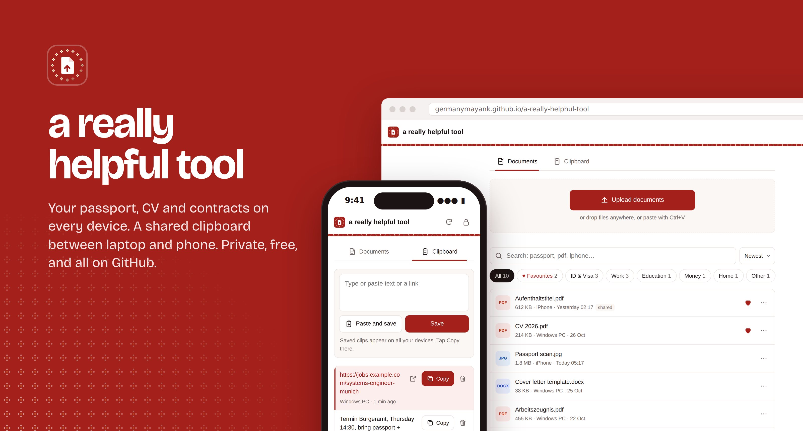
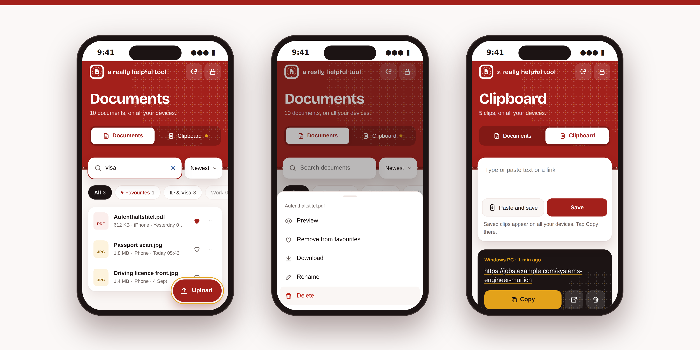
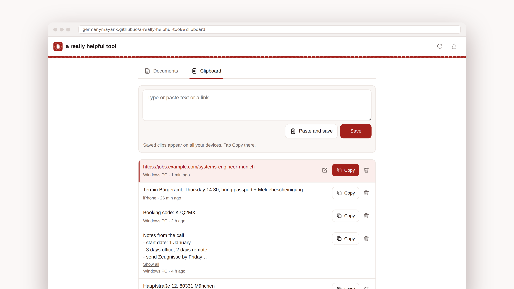

<a href="https://germanymayank.github.io/a-really-helphul-tool/"></a>

<p align="center">
  <a href="https://github.com/GermanyMayank/a-really-helphul-tool/actions/workflows/ci.yml"></a>
  
  
  
  <a href="LICENSE"></a>
</p>

<h3 align="center">
  <a href="https://germanymayank.github.io/a-really-helphul-tool/">Open the app</a>
  &nbsp;&nbsp;|&nbsp;&nbsp;
  <a href="docs/SETUP.md">Make your own</a>
  &nbsp;&nbsp;|&nbsp;&nbsp;
  <a href="docs/ARCHITECTURE.md">How it works</a>
</h3>

<br>

Somebody asks for your passport scan, your Aufenthaltstitel or last year's Arbeitszeugnis, and it is on the other laptop, or in an email from 2023, or nowhere. This app fixes that. Open one link on any phone or computer, type your password once, and every important document is there to preview, send or download.

It also has a shared clipboard: copy a link on the laptop, tap Copy on the phone.

There is no server and no database. The app is a static page on GitHub Pages, and your files sit in a private GitHub repo that only you can open. It costs nothing to run.

## Documents



| | |
|---|---|
| **Upload from anywhere** | Big upload button on phones, drag and drop on a laptop, or paste a screenshot with Ctrl+V. Exact duplicates are spotted and skipped. |
| **Sorts itself** | Files land in ID & Visa, Work, Education, Money, Home, Photos or Other by reading the file name in English and German (*Aufenthaltstitel*, *Mietvertrag*, *Lebenslauf*). |
| **Finds anything** | Search forgives typos (`pasport`) and understands file types (`pdf`, `photo`), devices (`iphone`), categories (`visa`) and dates (`march`, `week`). |
| **Favourites** | Heart a file and it stays at the top on every device. |
| **Opens instantly** | PDFs, images and text files preview at once. Files are cached on the device and start downloading as soon as your finger touches them. |
| **Hands files over** | Copy images and text to the clipboard, or send the real file to WhatsApp, Mail or AirDrop through the phone's share sheet. |
| **Forgiving** | Rename in one tap. Deleted files go to the **Trash** for 30 days and come back with one tap (or Undo right away). Every change is a git commit, so nothing is ever really lost. |
| **Remembers where files came from** | Each file shows the device it was uploaded from and when. |
| **Installs like an app** | Add it to your home screen and it opens full screen, even without a connection. |
| **Backup in one tap** | Download every document in one zip, any time. |
| **Dark mode** | Follows your phone or laptop, in maroon-black with the kumkum header. |

## Clipboard



Copy something on the laptop, open the Clipboard tab and click **Paste and save** (or just press Ctrl+V). On the phone, tap **Copy** on the top clip. It works the other way round too.

New clips show up within about ten seconds, with the device they came from. Every link in a clip can be tapped, long notes fold away, and deleting has Undo. Bookmark `.../#clipboard` on your phone's home screen to land straight on it.

Clips live in your private vault like your documents, but they are not end-to-end encrypted, so keep bank passwords out of it.

## How it stays private

```
 Phone / laptop                          GitHub
 ┌─────────────────────┐   HTTPS + key    ┌──────────────────────────────┐
 │ this app            │ ───────────────▶ │ your vault repo  (PRIVATE)   │
 │ (GitHub Pages,      │                  │   files/Passport.pdf         │
 │  public code only)  │ ◀─────────────── │   files/CV.pdf  ...          │
 └─────────────────────┘                  └──────────────────────────────┘
          ▲
          └── your password unlocks the access key, which is stored
              AES-256 encrypted in config.js
```

- The **code** in this repo is public. Your **documents** live in a separate **private** repo that only your key can open.
- The key is a fine-grained GitHub token limited to that one repo. It is stored encrypted (PBKDF2 with 600,000 rounds and AES-256-GCM), so without your password it is useless.
- A strict Content Security Policy blocks every script and connection except this site and `api.github.com`. No trackers, no CDNs, no third-party code.
- The lock button wipes the key, every cached file and the cached clipboard from that device.

More in [docs/ARCHITECTURE.md](docs/ARCHITECTURE.md). Found a problem? See [SECURITY.md](SECURITY.md).

## Make your own (about 15 minutes, browser only)

1. **Fork** this repo. In your fork, enable Actions, then set **Settings > Pages > Source** to **GitHub Actions**.
2. Create a **private** repo for your documents, for example `docsync-vault`.
3. Create a [fine-grained token](https://github.com/settings/personal-access-tokens/new) for only that repo with **Contents: Read and write**.
4. Open `https://<you>.github.io/<your-fork>/setup.html`, paste the token, choose a password, and paste the result into `config.js`.
5. Open the app on any device and unlock.

Every step, click by click: **[docs/SETUP.md](docs/SETUP.md)**. To get new versions later, press **Sync fork** on your repo page.

## For developers

Plain HTML, CSS and JavaScript modules, no framework and no build step. Read `assets/app.js` top to bottom and you know the app.

```
index.html            the app
sw.js                 offline start: keeps the app (never your documents) on the device
about.html            public front page: what the app is, how it works
setup.html            one-time setup: encrypts your token into config.js
config.js             the only file a user edits
assets/
  app.js              UI, in numbered sections
  github.js           the only code that talks to GitHub
  state.js            SyncedFile engine + synced favourites
  clips.js            shared clipboard
  organize.js         categories, search, sorting (pure functions)
  zip.js              backup zip writer (pure functions)
  trash.js            trash names, ages and the 30-day rule (pure functions)
  version.js          version number + What's new notes
  meta.js             where and when each file was uploaded
  blobs.js            file cache, prefetch, duplicate check
  crypto.js           token encryption
  style.css           all styles and colour tokens
  about.css, about.js the front page
  fonts/              Bricolage Grotesque for headings (SIL OFL)
scripts/
  build-site.sh       copies the site and cache-busts it for deploy
  screenshots.mjs     README screenshots from a fake vault
  compose-images.mjs  frames them into the README images
tests/e2e.mjs         198 browser checks against a fake GitHub
.github/workflows/    test on every push, deploy to Pages when green
```

```bash
npm install && npx playwright install chromium
npm run build && python3 -m http.server 8080 --directory _site &
npm test               # every check must print "ok"
npm run screenshots    # refresh the README images
```

The tests and screenshots fake the whole GitHub API, so no token is needed and no real document ever appears in this repo. See [CONTRIBUTING.md](CONTRIBUTING.md), or [docs/AI_HANDOFF.md](docs/AI_HANDOFF.md) to continue the work with another AI.

## Design

Bold and warm, taken from Saurashtra and Kathiyawad in Gujarat. Every screen opens with a **kumkum** red header (`#a3201b`) printed with **bandhani**, the tie-dye dots of Jamnagar, and hemmed with a bandhani strip. **Haldi** yellow (`#e3a21a`) marks the things you reach for: Upload, Copy, a new clip. Text is ink on warm cotton white, and headings are set in Bricolage Grotesque. The colours are tokens at the top of `assets/style.css`.

## Ideas for next versions

A live upload progress bar (4.1), a "Recent" shortcut, and uploads up to 100 MB. The full list is in [docs/AI_HANDOFF.md](docs/AI_HANDOFF.md).

## License

[MIT](LICENSE) © 2026 Mayank
